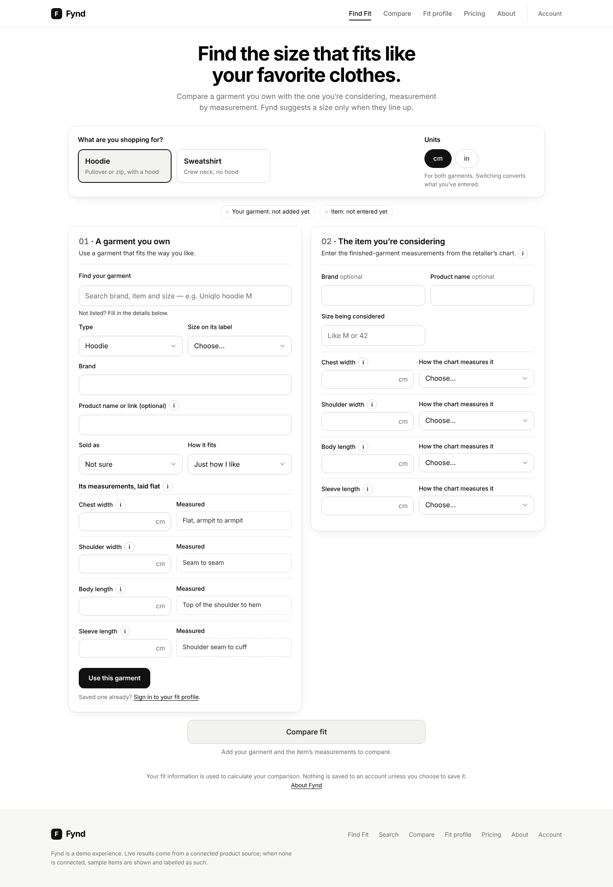
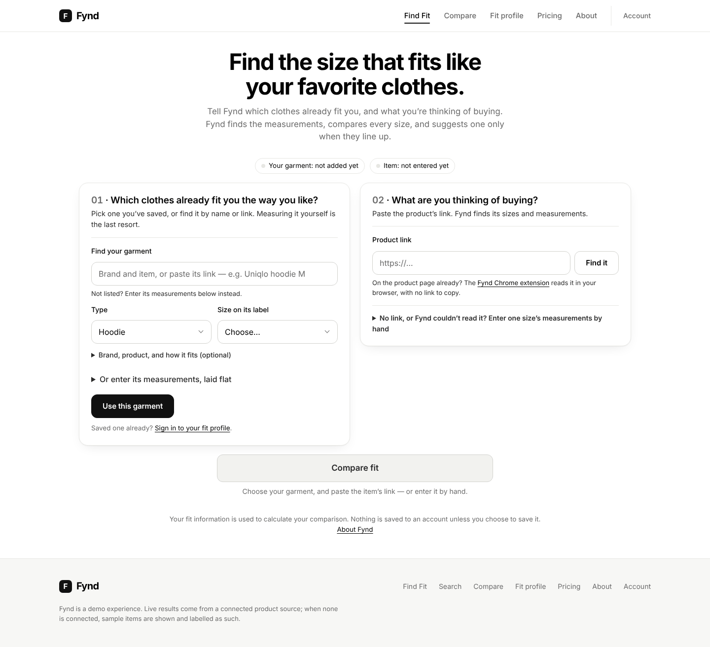
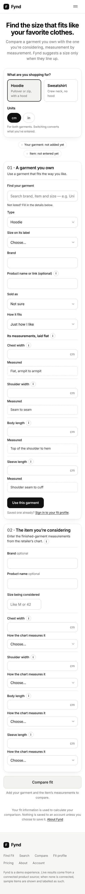
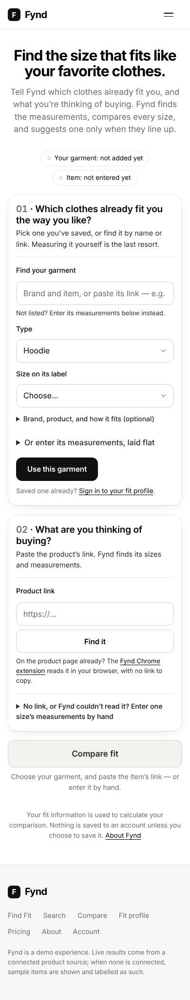

# Find Fit redesign: before and after, measured

Every number here was measured, not estimated. Two scripts produced them:

- **`scripts/find-fit-walkthrough.js`** runs the same shopper tasks on the old
  page (`main`, `42cd6f7`) and the redesign, in Chromium, against Fynd's real
  API handlers. It counts every **input**: a field typed, a choice made, a box
  ticked. Button presses are counted separately.
- **`scripts/find-fit-links.js`** pastes every product link Fynd knows into the
  real page.

The garments are invented. The products are Fynd's own sizing records.

## Effort to one recommendation

The same task in each case: the shopper owns a hoodie that fits and is
considering Zara's Basic Heavyweight Hoodie. Both pages reach the same answer,
**size M**.

| | Before (`main`) | After |
|---|---|---|
| **Returning customer** (a hoodie saved on their fit profile) | **9 inputs**, 1 press: the size being considered, 4 measurements, 4 "how the chart measures it" dropdowns; Compare fit | **2 inputs**, 1 press: the product link, the tick "these match the size chart on the product page"; Find it\* |
| **First-time customer** (no account; their hoodie measured at home) | **15 inputs**, 2 presses: the garment's brand, size and 4 measurements; Use this garment; then the item's 9; Compare fit | **6 inputs**, 2 presses: open "Or enter its measurements"; the 4 measurements; the link; the tick |
| **Controls visible on opening the page** | 26 | 4 (the garment's search, type and size, and the item's link) |

The page's own counter (`assets/fit-metrics.js`) agrees: 2 and 6.

\*Pasting the link looks the product up by itself; typing it needs "Find it".
Either way, the comparison runs on the tick, with no Compare press.

## Which product links Fynd handles

Every link was pasted into the real page, using the data as deployed today:

| What happens | Links | What the shopper does |
|---|---|---|
| **Automatic:** a checked record of the product's garment measurements | none in production yet. With the UNIQLO pair marked checked (the tests' fixture), both of their links are automatic | nothing; every size is compared at once |
| **Measurements found, one tick:** Fynd's own unchecked copy of the brand's garment chart | 9: UNIQLO Sweat Pullover Hoodie, Sweatshirt, SUPIMA Cotton T-Shirt, Sweat Oversized Pullover Hoodie; Zara Basic Medium Weight T-Shirt, Basic Relaxed Fit Hoodie, Basic Heavyweight Hoodie, Compact Boxy Fit Hoodie, Relaxed Fit Hoodie Sweatshirt | the tick |
| **Body chart only:** never compared with a garment | 5: Nike Club crew, Nike Premium Essentials tee, Carhartt Marquette hoodie and crewneck, H&M Regular Fit tee | the extension (if the page shows garment measurements) or hand entry |
| **Unreadable from Fynd's server** (no record, and no retailer cleared for server reading) | any other shop; product pages Fynd has no record of; the Nike Club hoodie's stored link (it lacks the product code its record matches on, which is a data issue) | the Chrome extension, which reads the page in the shopper's browser, or hand entry |

**Measurements really retrieved.** On all 9 "one tick" links, every value the
page shows was compared with the brand's figure in Fynd's record: **244 of 244
match, 0 differ.** The values come from the record; none are typed or invented.

## Screenshots

**First sight:**

| Before | After |
|---|---|
|  |  |
|  |  |

**Returning customer:**

1. `after/returning-01-open.png`: the saved hoodie is already chosen.
2. `after/returning-02-product-found.png`: the link pasted, with the product,
   its sizes and its measurements found.
3. `after/returning-03-result.png`: after the tick, the result.
4. `after/returning-04-result-phone.png`: the same result on a phone.

Before: `before/returning-02-item-typed.png`, the item typed by hand, then
`before/returning-03-result.png`.

**First-time customer:**

1. `after/first-time-02-garment-measured.png`
2. `after/first-time-03-product-found.png`
3. `after/first-time-04-result.png`
4. `after/first-time-05-result-phone.png`

Before: `before/first-time-02-garment-kept.png`, then
`before/first-time-03-item-typed.png`, then `before/first-time-04-result.png`.

## What remains manual, and why

- **The tick.** Fynd's copies of brand charts aren't checked yet, so the shopper
  confirms them against the product page. Checking the records removes the tick.
- **The size on a garment's label.** It is needed when the garment is identified
  by product, because it decides which published measurements stand in for the
  shopper's own.
- **Measuring at home.** It is needed for a first-time shopper whose garment
  Fynd holds no checked record of, which today is every garment.
- **Shops Fynd has no record of.** They need the extension or hand entry.
